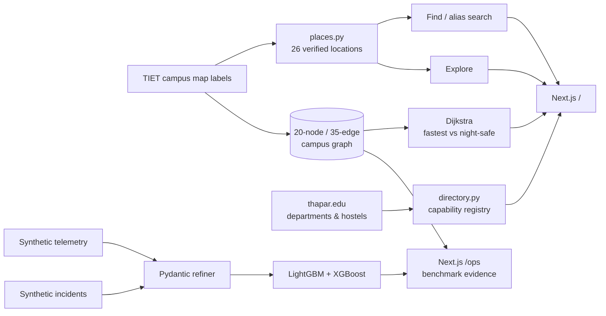

# CampusPulse

**Find any place on the TIET campus. Know how to get there.**

CampusPulse is a working FastAPI + Next.js campus app built on verified TIET map labels. A fresher can search the names students actually use ("cold coffee", "vending machine", "Vahni"), see the place on the real campus map, and follow a walking route with a last-50-metre entrance cue. A separate Ops view exposes the forecasting, triage and routing engine and its benchmark evidence.

Nothing in this repository invents a location, a co-ordinate, a faculty cabin or a live seat count. Where TIET does not publish data, the app says **not connected** instead of showing a fabricated number.

---

## Two surfaces

| Route | Audience | What it shows |
|---|---|---|
| `/` | Students | **Find / Explore / Navigate** over 26 verified campus locations |
| `/ops` | Judges and staff | Crowd forecasts, incident triage, mess planning, routing benchmark, CSI |

The consumer app is the product. The Ops dashboard is the evidence room.

---

## 60-second audit

```bash
python -m pip install -r requirements-dev.txt

python -m pytest -q                 # 46 tests
python -m src.evaluate              # rewrites results/benchmark_metrics.json
python -m src.export_snapshot       # rewrites frontend/public/data/snapshot.json
uvicorn src.api:app --reload        # Pydantic contracts at http://127.0.0.1:8000/docs

cd frontend && npm install && npm run dev
```

| Command | Verifiable outcome |
|---|---|
| `pytest -q` | 46 passing tests, including directory integrity, leakage guards, validation failures and API contracts |
| `python -m src.evaluate` | Baselines, ablations, group-aware splits, latency and a dataset fingerprint |
| `python -m src.export_snapshot` | 26 places, 8 queued incidents, honest service registry, one JSON payload |
| `npm run build` | Production build of `/` and `/ops` |
| `/docs` | Every endpoint has a Pydantic-typed request and response schema |

The trained bundle is committed at `models/campus_pulse.joblib`; `src.train` rebuilds it from the seeded CSVs in `data/raw/`.

---

## 1. The problem this solves

A new student arrives with a campus map and no vocabulary. The map says `AAHAR`; seniors say "mess". The map says `MAIN ADMN`; the fee counter is somewhere inside. A shared photo of the map helps only if someone draws the path for you.

CampusPulse makes that interaction explicit:

1. **Find** by official label or student alias, with every hit naming its source.
2. **Explore** by category instead of guessing building codes.
3. **Navigate** on the real map with a modelled route and a real-world last-50-metre cue.

The same graph also powers night-risk routing and a simulated golf-cart dispatch demo, but those are supporting capabilities, not the headline.

---

## 2. Find / Explore / Navigate

### Find

- 26 locations, 100+ aliases. `cold coffee` resolves to Food Court, `vending machine` to TAN Block, and `hostels` lists all three map-verified halls.
- Results carry a verification badge: **Campus map**, **Official source**, **Unverified** or **Simulated**.
- Faculty queries surface the departments TIET actually publishes and state plainly that individual cabins are not published.
- Availability queries surface a capability card instead of a made-up number.

### Explore

- Seven groups with counts: Academic & study, Hostels, Food & mess, Campus facilities, Sports, Gates & transport, Landmarks.
- The four headline cards match what freshers ask for: academic blocks, hostels, food and mess, campus facilities.
- Every row shows the printed map label and the last-50-metre landmark.

### Navigate

- Destination picker over all 26 places; origin restricted to map-verified starts (Main Entrance, North Gate, Vahni Hall). No GPS permission is requested or faked.
- Two routes on the TIET image: **lowest risk** (night-weighted) and **shortest**, drawn as SVG polylines over `campus-map.jpg`.
- Route summary: distance, ETA, risk index, numbered steps, final landmark, and a clearly labelled **simulated** cart ETA.
- Clicking a pin opens that place.

---

## 3. Data honesty contract

Every place carries a `verification` field:

| Value | Meaning | Example |
|---|---|---|
| `map` | Label is printed on the shared TIET campus map | `CS BLOCK`, `AAHAR`, `PRITHVI HALL`, `OAT` |
| `official` | Published on thapar.edu | Department list |
| `third-party` | Published elsewhere and possibly stale | Not used in the current directory |
| `unverified` | Plausible, but no primary source confirms it | Sports ground area, North Gate |
| `demo` | Simulated service used to demonstrate a capability | Golf cart stops, cart ETAs |

Every capability carries a `status`:

| Status | Meaning |
|---|---|
| `connected` | This repository has the data and uses it |
| `partial` | Some public data exists, the rest does not |
| `demo` | Deterministic simulation, labelled as such |
| `not_connected` | No data source; the app refuses to invent one |

Current registry (11 capabilities):

| Capability | Status | Why |
|---|---|---|
| Place & alias search | connected | 26 map labels + aliases |
| Campus wayfinding | connected | 20-node graph, verified anchors |
| Faculty directory | partial | TIET publishes departments, not cabins |
| Hostel directory | partial | Hall names from the map; allocation is with the hostel office |
| Crowd forecasting | demo | Synthetic replay telemetry |
| Incident triage | demo | Synthetic reports |
| Mess planning | demo | Synthetic history |
| Golf cart dispatch | demo | Deterministic simulator, no GPS feed |
| Library seat availability | not_connected | TIET does not publish live counts |
| Course-to-room lookup | not_connected | Timetable is not open data |
| Live shuttle tracking | not_connected | No vehicle feed |

The UI renders these states; it never replaces `not_connected` with a plausible-looking number.

---

## 4. Verified location directory

[`src/places.py`](src/places.py) holds 26 entries. Labels were read from high-resolution crops of the shared TIET map, not guessed.

| Group | Locations |
|---|---|
| Academic | CS Block, G Block, B Block, C Block, Central Library, LP 101-103, LP 110-111, Dean Office |
| Hostels | Prithvi Hall, Vyom Hall, Vahni Hall |
| Food | Canteen, Aahar, Streat Cafe, Food Court |
| Facilities | Main Administrative Block, Stationery & ATM, TAN Block, Staff Quarters |
| Sports | Sports Complex (unverified label) |
| Transit | Main Entrance, North Gate (unverified label), three golf cart stops (demo) |
| Landmark | Open Air Theatre (OAT) |

Sub-locations share a graph node deliberately: LP 101-103, LP 110-111 and the Dean Office all sit beside the Library, so routing to any of them reaches the library block. The detail panel still shows the exact printed label.

Each entry also stores `description`, `landmark`, `floor`, `open_hours`, `source`, `popular` and `aliases`. `tests/test_directory.py` enforces unique IDs and aliases, valid graph nodes, the verification enum, and that no entry claims live availability.

Departments come from <https://www.thapar.edu/faculties>; hostel counts come from <https://www.thapar.edu/students/pages/hostels>. Both are labelled `official`. We do not map departments to blocks, because TIET does not publish that mapping.

---

## 5. Architecture



Design invariants:

- **One graph.** Places, routes, carts and forecasts share node IDs.
- **One refiner.** Telemetry and incidents pass through the same validation, dedupe and staleness rules.
- **One model bundle.** Forecast, triage, SLA and mess artifacts load from one joblib file.
- **One snapshot.** `/` and `/ops` render the same engine output; neither can drift into invented numbers.

---

## 6. Graph and routing

[`src/graph.py`](src/graph.py) defines 20 nodes and 35 edges labelled with the names printed on the TIET map: Main Entrance, CS/G/B/C Blocks, Central Library, Canteen, Streat Cafe, Aahar, Food Court, Prithvi/Vyom/Vahni Hall, Stationery & ATM, TAN Block, Main Administrative Block, Staff Quarters, Sports Complex, North Gate and OAT.

Edges carry `distance_m`, `lit`, `cctv`, `stairs` and `footfall`. Risk is composed dynamically:

- lighting and CCTV penalties with a **night multiplier**,
- crowd pressure from refined telemetry,
- active incident density near the edge,
- stair exclusion when accessibility is requested.

Dijkstra runs twice — once on distance, once on risk-weighted cost. Route P50 is **0.18 ms**; the browser receives both routes and switches instantly.

Distances are modelled from pixel anchors and typical walking speeds. They are **not survey-grade**; the UI says so.

---

## 7. Machine-learning evidence

All numbers below are produced by `python -m src.evaluate` and stored in [`results/benchmark_metrics.json`](results/benchmark_metrics.json).

### Crowd forecast

LightGBM quantile P10/P90 + LightGBM/XGBoost median blend, chronological 70/15/15 split, causal features only.

| Horizon | Model MAE | Persistence MAE | Model R² |
|---|---:|---:|---:|
| 15 min | 0.0283 | 0.0420 | 0.9399 |
| 30 min | 0.0315 | 0.0600 | 0.9362 |
| 60 min | 0.0373 | 0.0934 | 0.9238 |
| Overall | **0.0324** | 0.0651 | **0.9333** |

Ridge baseline 0.0599 MAE / 0.864 R²; seasonal naive 0.0879 / 0.652. Improvement over seasonal naive: **63.2%**.

### Incident triage

XGBoost severity P0–P3 + LightGBM SLA, group-aware split by incident cluster so paraphrases cannot leak.

| Model | Accuracy | Macro-F1 |
|---|---:|---:|
| Production (structured + text) | **0.8580** | **0.7850** |
| Logistic regression | 0.8225 | 0.5696 |
| Majority class | 0.5030 | 0.1673 |

SLA MAE 24.9 min. Per-class F1: P0 0.9266, P1 0.7966, P2 0.7500, P3 0.6667. Adding embeddings **lowered** macro-F1 to 0.7386, so embeddings are used for dedupe and retrieval only. The negative result stays in the benchmark.

### Dedupe

| Method | Pair precision | Pair recall | Pair F1 |
|---|---:|---:|---:|
| Category + distance + time + embedding gate | **1.0000** | **0.9737** | **0.9867** |
| Exact normalized text only | 0.3167 | 0.1656 | 0.2175 |

`evidence_snippets` quote the source reports behind each ticket, capped at 140 characters.

### Mess demand

Headcount MAE **26.26** (seasonal baseline 48.81), MAPE **6.92%**, waste MAE **11.23 kg**, R² **0.9795**. Savings are floored at zero.

### Routing and dispatch

- 75 night origin-destination pairs: mean risk reduction **28.9%** for **+7.2%** distance.
- Median reduction is **0.0%** — many pairs have no safer alternative, so the app recommends the shortest path rather than inventing a detour.
- Cart dispatch over 120 requests: **1.95 min** mean ETA versus **4.87 min** random, a **60.0%** reduction.

### Latency

| Operation | P50 | P95 |
|---|---:|---:|
| Forecast | 68.43 ms | 77.77 ms |
| Place search | 0.75 ms | 0.96 ms |
| Triage | 27.05 ms | 34.49 ms |
| Route | 39.04 ms | 52.03 ms |

---

## 8. API

| Method | Path | Purpose |
|---|---|---|
| GET | `/api/v1/health` | Engine, embedder backend, graph size, loaded models |
| GET | `/api/v1/graph` | Shared campus graph |
| GET | `/api/v1/snapshot` | Full payload, optionally `?as_of=` |
| GET | `/api/v1/places?q=` | Lexical + semantic place search |
| GET | `/api/v1/find?q=` | Universal search: places, departments, capability status |
| GET | `/api/v1/departments` | TIET departments with source |
| GET | `/api/v1/services` | Capability registry and honest status |
| POST | `/api/v1/route` | Fastest vs risk-weighted route, night/accessible modes |
| GET | `/api/v1/forecast/{node_id}` | P10/P50/P90 at `?horizons=15,30,60` |
| GET | `/api/v1/hotspots` | Ranked crowd and queue pressure |
| POST | `/api/v1/incidents` | Validate, triage, cite evidence, choose playbook |
| GET | `/api/v1/incidents/queue` | Active clusters sorted by severity |
| GET | `/api/v1/mess/plan` | Headcount, prep kg, expected waste and savings |
| GET | `/api/v1/carts` | Simulated fleet positions |
| POST | `/api/v1/carts/dispatch` | Simulated nearest-cart ETA and alternatives |
| GET | `/api/v1/stress` | Campus Stress Index with components |
| GET | `/api/v1/benchmarks` | Raw benchmark JSON |
| GET | `/api/v1/demo-scenario` | One Wi-Fi flood across triage, routing and mess |

```bash
curl "http://127.0.0.1:8000/api/v1/find?q=cold%20coffee"
curl -X POST http://127.0.0.1:8000/api/v1/route \
  -H "Content-Type: application/json" \
  -d '{"origin":"gate_main","destination":"library","night_mode":true}'
```

---

## 9. Tests

```bash
python -m pytest -q
# 46 passed
```

| File | What it proves |
|---|---|
| `tests/test_directory.py` | Unique IDs and aliases, real graph nodes, verification enum, no live-availability claims, honest service states |
| `tests/test_graph.py` | Edge symmetry, valid walks, fastest ≤ safest distance, night lighting preference, accessibility, unknown nodes |
| `tests/test_refiner.py` | Telemetry caps and staleness, dedupe gates by category/node/time, invalid rows, embedding thresholds |
| `tests/test_features.py` | No future leakage, horizon targets, numeric contract, triage excludes embeddings, mess contract |
| `tests/test_engine.py` | Forecast bounds, determinism, hotspot ordering, night routing, alias search, `find()` intent routing, cart dispatch, triage evidence, mess savings, CSI weights, snapshot cache |
| `tests/test_api.py` | Every endpoint plus 404/422 behaviour, `/find`, `/departments`, `/services` |
| `tests/test_integration.py` | One graph across places/routes/carts, refiner accounting, NaN-free JSON, benchmark receipt |

---

## 10. Run locally

```bash
python -m venv .venv
# Windows
.venv\Scripts\activate
# macOS / Linux
source .venv/bin/activate

python -m pip install -r requirements-dev.txt
python -m src.train          # optional, rebuilds models/campus_pulse.joblib
python -m src.evaluate
python -m src.export_snapshot
uvicorn src.api:app --reload --port 8000
```

```bash
cd frontend
npm install
npm run dev                  # http://127.0.0.1:3000
npm run build                # production check
```

Optional MiniLM upgrade:

```bash
python -m pip install -r requirements-embeddings.txt
# The engine auto-detects sentence-transformers; otherwise the deterministic
# 384-d hashing embedder keeps tests and demos offline.
```

---

## 11. Honest evaluation and limitations

- **Synthetic telemetry by design.** Crowd, incidents and mess history come from a seeded digital twin. The forecast, triage and mess metrics measure recovery of simulated ground truth, **not** real-world accuracy.
- **Map labels are real; distances are modelled.** Place names and landmarks were read from the shared TIET map. Edge distances and pixel anchors are approximations.
- **Unverified is a real state.** The Sports Complex area and North Gate are not individually labelled on the shared map, so they are marked `unverified` rather than promoted to fact.
- **No faculty-to-cabin mapping.** TIET publishes departments, not office allocations. The app lists departments and stops there.
- **No live availability.** Library seats, room schedules and shuttle GPS are `not_connected`. Only simulated cart ETAs are shown, and they are labelled.
- **Negative results are kept.** The triage embedding ablation and the 0% median route improvement are documented, not hidden.
- **No personal data.** Incident reporters are truncated hashes. No real student emails, phone numbers or chats are included.

Roadmap, in order of value:

1. Replace the digital twin with real Wi-Fi, queue-counter and mess-entry adapters.
2. Add a timetable import once the institute exposes it, with explicit `official` verification.
3. Add structured incident updates and conflict detection.
4. Survey route distances to replace modelled metres.
5. Add a human review queue for low-confidence triage.

---

## 12. Repository structure

```text
src/
  config.py          seeded constants, thresholds, paths
  schemas.py         Pydantic v2 contracts, verification and service states
  graph.py           20-node / 35-edge campus graph with map labels
  places.py          26 verified locations, aliases, sources
  directory.py       departments and capability registry
  simulator.py       deterministic digital twin
  refiner.py         validation, winsorization, incident dedupe
  features.py        causal telemetry, triage, mess features
  embeddings.py      MiniLM + hashing fallback
  train.py           LightGBM / XGBoost training and bundle
  llm.py             grounded synthesis with deterministic fallback
  engine.py          find, forecasts, routing, dispatch, triage, mess, CSI
  evaluate.py        baselines, ablations, latency, benchmark JSON
  export_snapshot.py static payload for both frontend surfaces
  api.py             FastAPI surface

frontend/
  app/               `/` consumer app, `/ops` evidence dashboard
  components/        CampusApp, CampusPhotoMap, Dashboard, charts
  lib/               typed snapshot contracts, map anchors
  public/            campus map, snapshot payload

models/campus_pulse.joblib
data/raw/*.csv
results/benchmark_metrics.json
tests/               46 pytest checks
.github/workflows/   CI: tests, benchmark, snapshot
```

---

## 13. Attribution

- Base campus map image in `frontend/public/campus-map.jpg` was shared by **thapar.helpclub29**. It is used as a visual layer for a student project; node anchors and route overlays are approximate.
- Department list and hostel counts are cited from thapar.edu and marked `official`.
- Built for the **Smart Campus & Student Life** hackathon theme.
- No affiliation with Thapar Institute of Engineering & Technology is implied.
